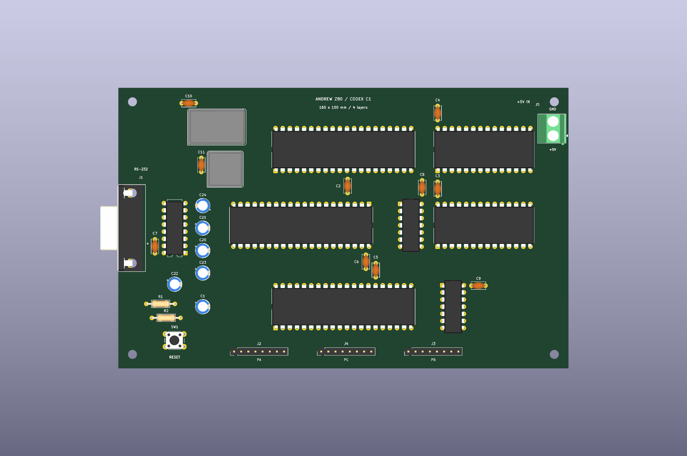

= Placement checkpoint: fresh Codex Eurocard
:title: {docname}
:author: Falken and Ari / Codex
:revdate: 2026-11-08
:toc:
:sectnums:

== Result

The first layout experiment now has a fresh native PCB placement with all 38 footprints on a 160 x 100 mm Eurocard. The design has four copper layers: front signals, inner ground, inner +5 V, and back signals. The two power planes are filled. There are no signal tracks or vias yet.

The board was created from the new schematic's native exported netlist with `pcbnew`; the historical Grok/AGY PCB was not loaded or repositioned. The layout uses horizontal DIP-40 and memory packages in three functional rows, with decoding and support components in the spaces between them. This creates a different placement for the workflow comparison while retaining the reference-compatible layer and routing rules.

* link:../layouts/01-reused-agy-router/Z80_Simple_Computer.kicad_pro[Working KiCad project].
* link:../layouts/01-reused-agy-router/Z80_Simple_Computer.kicad_pcb[Native placed board].
* link:../output/placement/3d-top.png[Native KiCad 3D rendering].
* link:../output/placement/top.svg[Top placement SVG] and link:../output/placement/top.png[PNG].
* link:../checkpoints/01-codex-placed-unrouted/Z80_Simple_Computer.kicad_pro[Preserved unrouted checkpoint project].

== Placement choices

[cols="1,2,3",options="header"]
|===
|Part or block |Courtyard center, mm / rotation |Reason
|U1 CPU
|80, 22 / 90 degrees
|Upper middle, with its data side towards the UART row and memory to the right.
|U3 ROM; U2 RAM
|130, 22 and 130, 49 / 90 degrees
|Aligned memory packages, short shared address/data region and room for the right-edge power inlet.
|U5 UART
|65, 49 / 270 degrees
|Middle left, between the CPU and serial interface, with its oscillator above the left end.
|U4 PIO
|80, 78 / 90 degrees
|Lower row adjacent to the three peripheral headers.
|U7 / U8 logic
|104, 49 and 119, 78 / 0 degrees
|Between the principal bus and memory/I/O regions, with room around each DIP-14.
|U6 MAX232
|20, 50 / 180 degrees
|Beside the left-edge DE9. Four pump/reservoir capacitors sit in a column just to its right; supply bypass parts sit below/left.
|Y1 / Y2
|35, 14 and 38, 29 / 0 degrees
|Separate clock modules in the upper-left area, clear of the serial connector and principal chip rows.
|J1 / J5
|Specified by pad-1 anchors rather than courtyard centers
|DE9 mating face points left and overhangs that edge. Screw-terminal wire openings point right. The terminal is inset enough to retain its complete silkscreen; numbered pads remain on the board. J5 polarity is labelled.
|J2 / J4 / J3
|50, 94 / 81, 94 / 112, 94; all 90 degrees
|PA, PC and PB headers along the lower edge, matching the PIO's physical port regions. The order and port names are labelled; these headers carry signal pins only.
|Reset parts
|Lower-left region
|Accessible pushbutton with adjacent timing/discharge parts, clear of the mounting hole.
|H1-H4
|5,5 / 155,5 / 5,95 / 155,95
|Four 3.2 mm M3 mounting holes inset 5 mm from the board edges.
|===

`tools/place_board.py` contains the fixed locations and a deterministic candidate search for the ten 100 nF bypass capacitors. The search uses the actual footprint courtyards and scores capacitor pad 1 distance from the corresponding IC's +5 V pad, with a 0.30 mm courtyard gap for candidate placement. It tries the four cardinal orientations and keeps capacitor pads on their specified nets.

The resulting supply-pad distances are 2.688-3.385 mm for the eight ICs and approximately 4.69 mm for the two oscillators. These are geometric pad-to-pad distances, not routed trace lengths or an SI measurement. Individual positions and distances are in link:../reports/placement/placement.json[the placement report]. Power is connected through the inner planes.

References and chip values are horizontal. Passive references are placed outside their bodies, and connector polarity/port labels remain visible. The native library footprints and their vendored models are retained.

== Verification and remaining connections

Native KiCad DRC reports:

* *0 placement/geometry/silkscreen violations.*
* *0 schematic parity issues.*
* *138 unconnected items*, expected at this unrouted stage.

The unconnected items are signal connections. Both power planes are filled and neither +5 V nor GND appears in the remaining unconnected list. The overall PCB is therefore not yet a fully routed or fabrication-ready result; the unconnected checks have not been disabled or excluded.

The additional native-board verifier checks:

* Exactly 38 footprints, with all 301 schematic pin assignments matching the actual PCB pad nets. Duplicate physical switch pads retain their shared pin assignments.
* The 160 x 100 mm outline, four-layer configuration, two filled power zones, and absence of tracks/vias.
* No courtyard overlaps. All non-overhanging footprints stay within the board, and pad centers are on the board.
* All ten bypass-capacitor supply-pad distances are below 5 mm.
* All 34 component-body STEP models resolve through the project-local library link. Mounting holes do not require models.

See link:../reports/placement/drc.json[native DRC] and link:../reports/placement/verification.json[placement verification]. The exported top view and native 3D rendering were visually inspected.

The 3D view uses bare DIP models. If sockets are used, their selected mechanical envelopes need checking against the nearby bypass parts. The four-layer assignment is recorded for routing comparisons; a fabricator-specific stackup and its electrical properties are not established by this placement.

== Preserved checkpoint and comparison discipline

`checkpoints/01-codex-placed-unrouted/` contains the board, matching schematic, project settings and library tables. Its relative `libs` link resolves to the shared vendored libraries. `checkpoint.json` records hashes of each native input file. Keep this snapshot unchanged and copy it into each routing experiment when that experiment begins.

The reference-compatible project rules remain 0.15 mm default signal width and clearance, 0.70/0.30 mm signal via diameter/drill, and 0.30 mm power-net clearance. These values match the AGY router's current constants. The project file is part of the checkpoint so later rule differences can be identified.

Only the first layout has a PCB at this stage. The other three layout folders retain their synchronized schematic projects. Future router comparisons must start from this same checkpoint to isolate routing differences; experiments that change placement should be identified separately.

== Reproduction and next stage

[source,shell]
----
/usr/bin/python3 tools/place_board.py
kicad-cli pcb drc --schematic-parity --all-track-errors --format json -o "$PWD/reports/placement/drc.json" "$PWD/layouts/01-reused-agy-router/Z80_Simple_Computer.kicad_pcb"
/usr/bin/python3 tools/check_placement.py
----

The generator refuses an active KiCad lock and refuses to overwrite a board whose hash differs from its last generated placement. This protects subsequent manual edits and routing. Native files regenerated from library footprints can acquire new object IDs; the preserved checkpoint's hashes identify the exact comparison input.

The next stage is to adapt the attributed AGY router to this experiment's paths and audit its obstacle handling for the rotated footprints. Begin with clocks and reset, refill zones, then check native DRC and parity before progressing through the other net groups. Keep each validated result and its reports. Avoid treating a successful path search as proof that the saved copper passes KiCad's checks.
