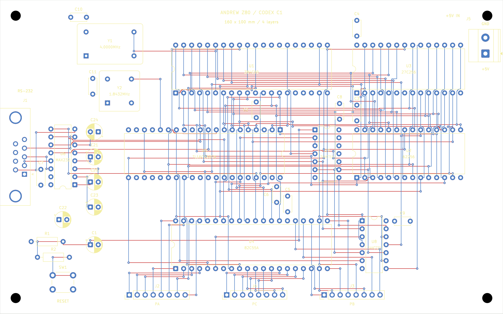
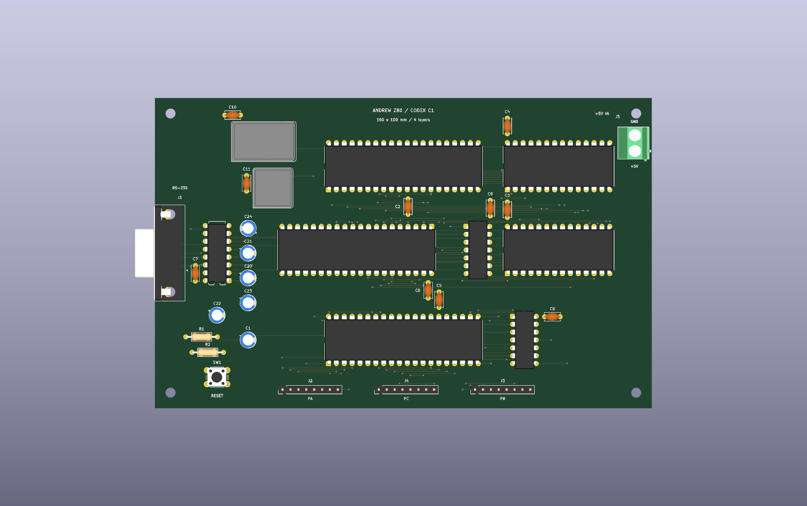

= Routed Eurocard: native verification and comparison with Grok/AGY
:title: {docname}
:author: Falken and Ari / Codex
:revdate: 2026-11-08
:toc:
:sectnums:

== Result and files to open

The first Codex layout is fully routed. A fresh native KiCad check with zone refill reports *zero DRC violations, zero unconnected items, and zero schematic-parity issues*. The authoritative schematic also has *zero ERC errors or warnings*. The new schematic, placement and routing now provide the first complete software-verified comparison result.

* Open link:../layouts/01-reused-agy-router/Z80_Simple_Computer.kicad_pro[the routed KiCad project] or link:../layouts/01-reused-agy-router/Z80_Simple_Computer.kicad_pcb[the native board].
* Inspect link:../output/routing/01-reused-agy-router/signals.png[both signal layers], link:../output/routing/01-reused-agy-router/top.png[top copper and silkscreen], and link:../output/routing/01-reused-agy-router/bottom.png[bottom copper viewed from the underside]. Matching SVG files are beside the PNGs.
* Inspect link:../output/routing/01-reused-agy-router/3d-top.png[top 3D] and link:../output/routing/01-reused-agy-router/3d-bottom.png[bottom 3D] renders.
* Read link:../reports/routing/verification.json[the independent native-board verification], link:../reports/routing/final-drc.json[final DRC], and link:../reports/routing/final-erc.json[final ERC].

This is a circuit/layout workflow milestone. The board has not been fabricated or tested in hardware, and the result is not a timing or signal-integrity qualification.

== What was implemented

The board retains the new Codex placement: a 160 x 100 mm four-layer Eurocard with 38 footprints, horizontal major DIP packages, outward-facing serial and power connectors, and local bypass capacitors. Signals use front and back copper; the two inner planes distribute GND and +5 V. The supply is external regulated +5 V.

The route uses the attributed AGY Manhattan implementation adapted for the new placement, as recorded in link:261108-1532-ROUTING-start.adoc[the routing-start note]. The source circuit and capture are documented separately in link:261108-1438-SCHEMATIC-base.adoc[the schematic handover]. This does not claim that the routing algorithm or the original Z80 circuit was independently invented by Codex.

There was no FreeRouting pass, interactive cleanup, 45-degree smoothing, component movement, or relaxation of the project rules during this route. Default signal tracks remain 0.15 mm wide with 0.15 mm clearance. Through vias use 0.70 mm copper diameter and 0.30 mm drills. Power-net clearance remains 0.30 mm. The additional 0.02 mm obstacle-mask allowance is conservative relative to those unchanged native rules.

All seven groups were accepted on their first native DRC check; no rejected copper candidate needed repair. The complete working board contains *1,200 track segments and 212 vias*, totaling *5,413.942 mm* of signal copper.

== Routing stages

Each stage includes the accumulated native board, matching schematic and project settings, library links, native DRC report, summary metrics and input/output hashes under `reports/routing/01-reused-agy-router/groupN/`. The working board was updated only after its candidate passed.

[cols="1,3,1,1,1,1",options="header"]
|===
|Group |Added nets |Nets |Runtime, s |Remaining connections |Accumulated vias
|1 |Clocks and reset |6 |9.15 |127 |12
|2 |MAX232, RS-232 and UART TTL serial |14 |13.65 |113 |30
|3 |Data bus D0-D7 |8 |17.00 |81 |74
|4 |Lower address and chip-select decode |9 |21.28 |64 |101
|5 |Control strobes and decode inputs |6 |20.45 |47 |129
|6 |Remaining upper address bus |11 |34.02 |25 |172
|7 |PIO ports and UART baud loop |25 |21.09 |0 |212
|===

The sum of the measured group runtimes is *136.64 seconds*. This includes routing, obstacle preparation, zone refill and per-group DRC, plus first-time compilation of the small distance-lookup helper. It excludes development, final independent checks, image export and documentation. Historical session runtime was not measured on the same basis, so no speedup claim is made.

== Comparison with the historical Grok/AGY board

Both native boards were read with the same installed KiCad 10.0.8. A fresh absolute-path DRC was also run against the preserved reference project with working local libraries. The measurements below are extracted from actual saved copper rather than screenshots or earlier prose claims.

[cols="3,2,2",options="header"]
|===
|Measurement |Historical Grok/AGY |Codex placement + adapted AGY router
|Dimensions and copper layers |160 x 100 mm, four |160 x 100 mm, four
|Signal copper length |5,036.484 mm |5,413.942 mm
|Front / back signal length |3,076.280 / 1,960.204 mm |2,832.631 / 2,581.312 mm
|Through vias |229 |212
|Track segments |1,700 |1,200
|Unconnected items |0 |0
|Schematic-parity issues |0 |0
|DRC error-severity findings |0 |0
|DRC warning-severity findings |66 |0
|===

The new result has *17 fewer vias* and *377.458 mm more signal copper* (approximately *7.49% longer*). It is a real tradeoff, not evidence that the newer placement optimizes every metric. Segment count depends on path fragmentation and is not an electrical-quality score.

The historical board's 66 current warnings comprise 54 silkscreen overlaps, 10 silk-over-copper findings and 2 silk-edge-clearance findings. Its copper remains completely connected, with no DRC errors or parity findings. See link:../reports/routing/reference-drc.json[the fresh reference report]. This distinguishes a clean copper result from a completely empty DRC report.

This is an *end-to-end workflow comparison*: placement, three UART input straps and documented router adaptations differ from the historical project. It is not an isolated comparison of router algorithms. Future router comparisons should use the common Codex unrouted checkpoint without moving components or changing the circuit/rules.

== Independent checks and visual review

`tools/check_routing.py` verifies the saved native output against both the native exported schematic netlist and the preserved placement input. It checks:

* All 301 electrical pin assignments on all 38 footprints.
* Unchanged footprint values, library identities, positions, orientations, pad geometry and pad nets.
* Unchanged board outline, project-settings hash and authoritative/snapshot schematic hashes.
* Four copper layers, the two expected filled power planes, outer-layer-only signal tracks, nonzero track lengths and correct widths.
* Through vias spanning front to back, with the expected diameter on all four layers and the expected drill.
* All seven accepted stage records and agreement between the final working-board hash and the final stage hash.
* Zero final native ERC/DRC/parity/unconnected findings.
* Matching hashes for all five native files in the untouched placed/unrouted checkpoint.

The earlier schematic connectivity and decoder checks were rerun and passed. All four experiment schematic snapshots remain synchronized. No new native rule exclusions were added.

The combined signal view, bottom copper view and native top 3D rendering were visually inspected. The route retains orthogonal grid geometry and short clearance-following jogs; there was no cosmetic smoothing pass. The bottom SVG/PNG is mirrored to represent viewing the physical underside. The native KiCad project remains the source for selecting and highlighting individual nets.

== Reproduce or continue

The working board and per-group boards already contain copper. The routing command skips groups listed as complete in the experiment manifest and protects against unexpected edits.

[source,shell]
----
/usr/bin/python3 tools/route_netgroup.py --group all
kicad-cli pcb drc --schematic-parity --all-track-errors --refill-zones --exit-code-violations --format json -o "$PWD/reports/routing/final-drc.json" "$PWD/layouts/01-reused-agy-router/Z80_Simple_Computer.kicad_pcb"
kicad-cli sch erc --exit-code-violations --format json -o "$PWD/reports/routing/final-erc.json" "$PWD/design/Z80_Simple_Computer.kicad_sch"
/usr/bin/python3 tools/check_routing.py
/usr/bin/python3 tools/export_routing.py
----

`pcbnew` comes from the installed KiCad environment; the distance helper is compiled using `g++`. No network service or additional Python package was needed. `rsvg-convert` renders the exported SVG review images.

For a fresh routing experiment, copy the preserved common input into that experiment's own directory and initialize its manifest deliberately. Do not reset the completed working board or edit the checkpoint to get a new run. The current router wrapper targets `01-reused-agy-router` specifically; another experiment needs its own wrapper/configuration and provenance.

The other three planned approaches remain open: a Codex-specific router, native interactive KiCad routing, and FreeRouting. The tscircuit investigation and future 51 x 51 mm eight-layer SMD/BGA module specification work remain separate later experiments. Completing this through-hole Z80 route does not demonstrate constrained high-speed or BGA routing support.
