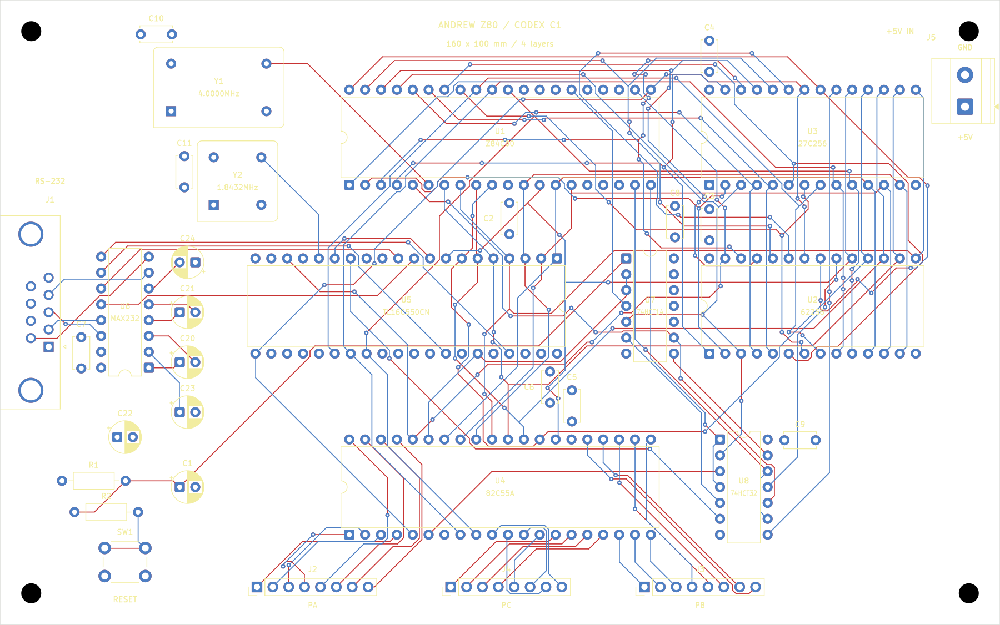

= Variant 2 complete: Codex octilinear router and controlled comparison
:title: {docname}
:author: Falken and Ari / Codex
:revdate: 2026-11-08
:toc:
:sectnums:

== Result and review files

The Codex-router variant is fully routed and passes the final native checks: *zero ERC findings, zero DRC violations, zero unconnected items, and zero schematic-parity issues*. It uses the same placed/unrouted input, circuit, footprint positions, outline, layer assignment and project rules as variant 1.

* Open link:../layouts/02-codex-router/Z80_Simple_Computer.kicad_pro[the variant 2 KiCad project] or link:../layouts/02-codex-router/Z80_Simple_Computer.kicad_pcb[the routed board].
* Review link:../output/routing/02-codex-router/signals.png[both signal layers], link:../output/routing/02-codex-router/top.png[top copper/silkscreen], and link:../output/routing/02-codex-router/bottom.png[bottom copper from the underside]. Matching SVG files are beside the PNGs.
* Review link:../output/routing/02-codex-router/3d-top.png[top 3D] and link:../output/routing/02-codex-router/3d-bottom.png[bottom 3D] renders.
* Evidence: link:../reports/routing/02-codex-router/verification.json[independent native-board verification], link:../reports/routing/02-codex-router/final-drc.json[final DRC], and link:../reports/routing/02-codex-router/final-erc.json[final ERC].
* Previous result: link:261108-1535-DONE-routing-and-comparison.adoc[variant 1 handover]. Its native board, project and schematic hashes were checked and remain unchanged.

The common placement's silkscreen legend is retained in both variants. Directory and document names identify the routing experiment; the common board legend denotes the placement revision.

== New planner and shared infrastructure

`tools/octilinear_router.cpp` is a new Codex implementation of direction-aware A*. Its search state includes position, outer copper layer and incoming heading. It searches horizontal, vertical and 45-degree moves, prices changes of heading explicitly, and disallows diagonal moves through blocked corners.

The new `tools/route_codex.py` wrapper grows multi-pin nets from a deterministic nearest-pad seed pair, adding each subsequent pad to the growing routed tree. Through-hole pads can connect the two signal layers without an added via. Each net's native tracks are then committed to the obstacle masks before routing the next net.

Shared code is attributed rather than presented as a new invention: pad/track/drill obstacle geometry, the seven net groups, native track/via emission, and copper metrics come from the audited variant-1 adapter `tools/route_netgroup.py`, itself adapted from AGY's original Python router. The stage/check/promotion workflow follows variant 1. No completed copper from variant 1 was imported.

The comparison changes planner behavior, routing costs and multi-pin growth strategy together. It does not isolate the benefit of a single feature such as diagonal moves.

=== Search costs

[cols="2,1,3",options="header"]
|===
|Operation |Cost |Meaning
|Preferred-axis 0.1 mm step |100 |Front prefers horizontal; back prefers vertical.
|Other-axis 0.1 mm step |125 |A soft layer-direction preference, less restrictive than variant 1.
|Diagonal grid step |146 |Approximately 0.1414 mm physical length, plus a small directional cost.
|Heading change |180 |Added bend penalty.
|Through-via layer transition |3000 |A higher relative via penalty than variant 1.
|===

These are route-search weights, not measured delay, impedance or manufacturing cost. The obstacle-free heuristic uses the minimum octile metric with straight/diagonal costs 100/141, ignoring bend, layer and obstacle penalties. Search costs stayed constant throughout all attempts.

The physical rules were unchanged: 0.15 mm signal width and clearance, 0.70/0.30 mm through vias, 0.30 mm power clearance, two inner power planes and signals on front/back only. The same conservative obstacle allowance and pad/drill protection were used. No cosmetic smoothing or component movement was needed.

== Congestion and retries

The first five groups completed on their first attempts. Group 6 required two rejected attempts before completion:

. With the original net order, A12 encountered a no-path result after the earlier address routes. The candidate had no native clearance/parity violations but was incomplete, so it was not promoted. Routing A12 alone from the group-5 board confirmed that the earlier group-6 routes affected its access.
. Routing A12 first completed more nets, but A14 reached the five-million-expanded-state limit. Reaching the limit does not prove that no route exists. That incomplete candidate was also rejected without replacing the working board.
. Prioritizing A14 and then A12, followed by the other group-6 nets in their original relative order, completed the group. Native DRC and parity were clean. The unchanged group-7 order then completed the board.

Failed attempts and native reports remain under `reports/routing/02-codex-router/group6/attempt-01/` and `attempt-02/`. The accepted group is `attempt-03/`. This was an explicit group-level ordering intervention through the wrapper's `--priority-net` option; the planner does not implement autonomous global rip-up or push-and-shove.

The stage records contain actual input/output hashes, code hashes, cost configuration, per-net state counts, route order, runtime, and DRC results. The first rejected attempt predates the wrapper's more detailed failure messages; its missing-net context is established by its recorded successful-net list and group sequence.

== Measured comparison

All lengths below are extracted from native saved track segments. Track length excludes the through-board length of vias; via count is reported separately.

[cols="3,2,2,2",options="header"]
|===
|Measurement |Historical Grok/AGY |Variant 1: adapted AGY |Variant 2: Codex
|Signal length, mm |5,036.484 |5,413.942 |4,959.519
|Front signal length, mm |3,076.280 |2,832.631 |2,611.755
|Back signal length, mm |1,960.204 |2,581.312 |2,347.765
|Through vias |229 |212 |129
|Track segments |1,700 |1,200 |787
|Unconnected items |0 |0 |0
|Native DRC errors |0 |0 |0
|Native DRC warnings |66 |0 |0
|===

Against variant 1, variant 2 uses *83 fewer vias (39.15% fewer)* and *454.423 mm less signal copper (8.39% less)*. Its native output contains 351 exact 45-degree track segments; small off-grid pad-entry segments are also permitted by the unchanged project rules. Segment count is affected by segmentation and is not itself a measure of electrical quality.

The controlled comparison is *variant 1 versus variant 2*: their circuit, placement and physical rules match. The historical project has a different placement and three different UART input straps, so its column is contextual rather than a controlled planner comparison. Its 66 warnings are the silkscreen findings already recorded in the variant-1 handover.

=== Runtime accounting

Variant 1 recorded 136.64 seconds across its seven first-pass accepted groups. Variant 2 recorded:

* Accepted groups: *113.58 seconds*.
* Rejected group-6 attempts: *21.16 + 21.54 seconds*.
* All recorded stage attempts: *156.28 seconds*.

These timings include the wrapper's obstacle preparation, routing, zone refill and per-stage native DRC; first-time local compilation is included when it occurred inside the timed stage. They exclude development, the diagnostic single-net probe, human time choosing a priority order, final independent checks, image export and documentation. The experiment does not demonstrate a total turnaround speedup. The completed geometry improves the measured copper/via metrics while the retries add work.

[cols="1,1,1,1,1,1",options="header"]
|===
|Group |Accepted attempt |Accepted runtime, s |Remaining connections |Accumulated vias |Accumulated signal length, mm
|1 |1 |8.18 |127 |0 |260.619
|2 |1 |14.01 |113 |3 |610.924
|3 |1 |15.15 |81 |23 |1,722.835
|4 |1 |15.88 |64 |39 |2,530.892
|5 |1 |16.25 |47 |63 |3,178.581
|6 |3 |20.52 |25 |120 |4,398.378
|7 |1 |23.59 |0 |129 |4,959.519
|===

== Verification and visual review

The final native DRC was rerun with zone refill, all-track checks, schematic parity and nonzero exit on findings. ERC was run on the layout's synchronized schematic. Both passed with no findings. All four experiment schematic snapshots remain current.

The extended `tools/check_routing.py --layout 02-codex-router` independently checks the saved native board against the original native netlist and common placement checkpoint: 38 footprints, all 301 pin assignments, footprint identities and geometry, positions/orientations, outline, circuit and project-setting hashes, four copper layers, two filled inner planes, track widths, via dimensions and spans, and the final accepted stage hash. It also verifies all five untouched checkpoint-file hashes and the preserved variant-1 board/project/schematic hashes. No rule exclusions were added.

`tools/check_octilinear_planner.py` provides separate small planner checks: exhaustive octile-distance comparison on a small grid, an unobstructed diagonal route, prevention of diagonal corner-cutting, and a wall crossing requiring exactly two layer transitions at permitted via sites. These checks supplement native DRC rather than replacing it.

The combined signal image, mirrored bottom-copper image and native top 3D render were visually inspected. The new paths use long straight/diagonal runs with fewer small orthogonal jogs. Visual review does not establish signal integrity or hardware operation.

== Reproduction and continuation

The accepted recipe, starting from a separately preserved copy of the common input with a freshly initialized variant-2 manifest, is:

[source,shell]
----
/usr/bin/python3 tools/check_octilinear_planner.py
/usr/bin/python3 tools/route_codex.py --group all --priority-net /A14 --priority-net /A12
kicad-cli pcb drc --schematic-parity --all-track-errors --refill-zones --exit-code-violations --format json -o "$PWD/reports/routing/02-codex-router/final-drc.json" "$PWD/layouts/02-codex-router/Z80_Simple_Computer.kicad_pcb"
kicad-cli sch erc --exit-code-violations --format json -o "$PWD/reports/routing/02-codex-router/final-erc.json" "$PWD/layouts/02-codex-router/Z80_Simple_Computer.kicad_sch"
/usr/bin/python3 tools/check_routing.py --layout 02-codex-router
/usr/bin/python3 tools/export_routing.py --layout 02-codex-router
----

On the completed experiment, the routing command skips already validated groups. Do not overwrite either completed variant to replay the experiment. The wrapper currently targets variant 2 specifically; clone/adapt its experiment path and initialize provenance deliberately for another run. Native new-track UUIDs can differ on regeneration even when route geometry is deterministic.

The next planned variant is native interactive KiCad routing, followed by the separately retained FreeRouting experiment. Dense SMD/BGA escapes, arbitrary outlines, differential-pair and length/skew constraints, fabricator stackup selection, SI and hardware qualification are outside the demonstrated capability of this board-specific grid planner. Those remain subjects for the future 51 x 51 mm eight-layer module work.
