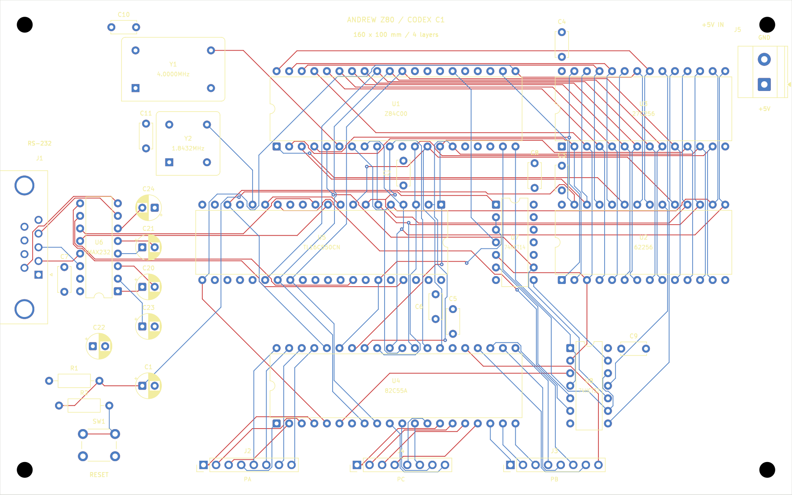
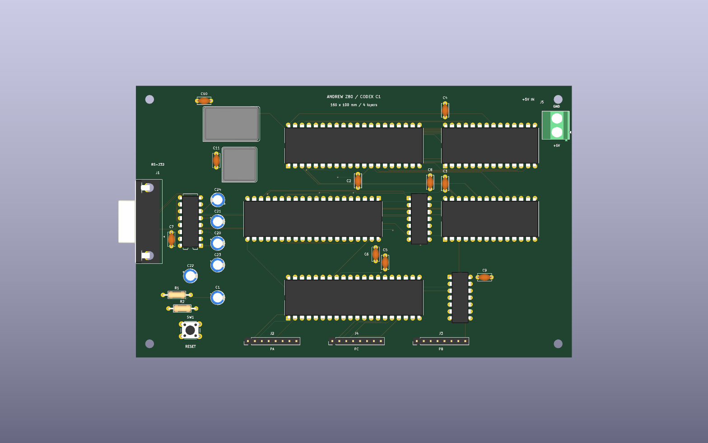

= FreeRouting comparison: verified MCP result and incomplete CLI controls
:title: {docname}
:author: Falken and Ari / Codex
:revdate: 2026-11-08
:toc:
:sectnums:

== Result and review files

The local official FreeRouting MCP run produced a complete native KiCad board. Final KiCad checks report *zero ERC findings, zero DRC violations, zero unconnected items and zero schematic-parity issues*. The board has *12 vias and 4,856.931 mm of signal copper*.

* Open link:../layouts/04-freerouting/Z80_Simple_Computer.kicad_pro[the FreeRouting KiCad project] or link:../layouts/04-freerouting/Z80_Simple_Computer.kicad_pcb[the verified native board].
* Review link:../output/routing/04-freerouting/signals.png[both signal layers], link:../output/routing/04-freerouting/top.png[top copper/silkscreen], link:../output/routing/04-freerouting/bottom.png[mirrored underside copper] and link:../output/routing/04-freerouting/3d-top.png[top 3D render]. Matching SVGs and a bottom 3D render are beside them.
* Evidence: link:../reports/routing/04-freerouting/verification.json[independent saved-board verification], link:../reports/routing/04-freerouting/final-drc.json[final native DRC] and link:../reports/routing/04-freerouting/final-erc.json[final native ERC].
* The native interactive experiment remains prepared and unrouted, as agreed: link:261108-1613-PENDING-native-interactive.adoc[variant 3 handover for a later GUI/control session].

The original common input and variants 1, 2 and the prepared variant 3 were preserved. The physical rules, footprint placement and circuit are unchanged. This is a software-verified layout result, not hardware, timing or SI qualification.

== Interface and release used

Falken requested the latest official FreeRouting MCP where possible, confirmed that he meant FreeRouting rather than a KiCad bridge, and also authorized a CLI control. He subsequently allowed falling back to CLI if MCP proved unreliable or obstructive.

The latest published stable release resolved during this task was https://github.com/freerouting/freerouting/releases/tag/v2.5.0[FreeRouting v2.5.0], published 2026-10-05. Its embedded local MCP server was used, following the release's https://github.com/freerouting/freerouting/blob/v2.5.0/docs/API/MCP.md[official MCP guide]. The public-service NPX bridge was not used.

The official JAR was downloaded into the task-local ignored cache. Its SHA-256 matched the release asset digest:

[source,text]
----
f6f51bb02245e8e717f9359bd260cc9c5c0b1bc0acc8b7cb2cd5b8ffeb5de3c7
----

`tools/freerouting_mcp.py` is a small task-local stdio client. It performed a real MCP initialization and discovery (31 tools), then used MCP tools to create a session/job, upload the local DSN, set and inspect job settings, start/poll the job, and download its SES output directly to disk. Protocol requests/responses and initialization evidence are retained under `reports/routing/04-freerouting/mcp/`. This is an actual MCP routing run, not a CLI run relabeled as MCP.

Both REST and MCP listeners were bound explicitly to `127.0.0.1`, analytics was disabled, and no PCB data was submitted to the public routing service. No global Codex MCP configuration was changed. Loopback sockets required sandbox escalation; the initial refused launch is recorded in the server log. A STOP marker requested shutdown of the task-owned server after result capture; the process exit was checked before handover.

== Common input, constraints and DSN handling

The preserved placed/unrouted checkpoint supplies the same 160 x 100 mm, four-layer board, 38 footprints and 301 electrical pin assignments as the earlier experiments. Native KiCad exported a raw DSN without modifying the source board. `tools/prepare_freerouting.py` reproduces the transport preparation from the protected checkpoint.

The normalized DSN makes the agreed restrictions explicit:

* F.Cu and B.Cu are the only routable signal layers. In1.Cu and In2.Cu are classified as power layers and disabled for signal routing.
* Existing GND and +5 V plane definitions are retained.
* Native 0.15 mm signal width/clearance and the 0.70/0.30 mm signal-via definition remain intact. The native power-net rules are retained.
* An unused SMD-specific clearance exception emitted by the exporter is raised from 37.5 to 150 um so it cannot weaken the native minimum. All actual components in this board are through-hole.
* Copper-to-edge and hole-clearance overrides are explicitly 200 um, matching the project's minimums. Automatic neckdown and fanout are disabled.

Raw and normalized DSNs, their hashes, and the normalization record are under `reports/routing/04-freerouting/`. These transport adjustments do not alter the native project rules or placement.

=== Parser-order problem found and corrected

This release's https://github.com/freerouting/freerouting/blob/v2.5.0/src/main/java/app/freerouting/io/specctra/parser/Structure.java[structure parser] reads the `autoroute_settings` scope only while its internal layer structure has not already been established. The settings therefore need to follow the layer declarations but precede the plane scopes.

Two earlier preparations were rejected during setup:

. Putting the settings before the layer declarations caused a layer lookup/parse failure. The effective-settings endpoint then returned a fallback configuration rather than establishing a valid loaded board.
. Putting the settings after the planes caused the settings contents to be consumed incorrectly by the surrounding parser. Both MCP and CLI returned tiny empty SES files and misleadingly reported completion for a board containing only two plane nets and no components.

The final preparation puts the settings between the layer declarations and boundary/planes. It loads the full board; the MCP routing job reports 99 nets. Earlier inputs, logs and empty outputs are retained under `setup-attempts/`. None was promoted to a working layout. This was a shared DSN/parser problem, not evidence of an MCP-only failure.

The effective-settings inspection also exposed a redundant `Power`-class exclusion while the board was incompletely loaded; that exclusion was removed. The final preflight had no validation warnings and confirmed exactly four layers with routability `[true, false, false, true]`.

== Routing configuration and MCP outcome

The requested configuration was 30 autorouter passes, up to 10 optimizer passes, one autorouter/optimizer thread, no fanout or automatic neckdown, strict DRC enabled, zero FreeRouting clearance tolerance, and a five-minute job budget. The DSN provides layer preferences and via costs. Requested and effective settings are saved separately.

The successful MCP job completed with zero reported unrouted connections and clearance violations. Its reported job duration was *73.402 seconds*, CPU time approximately *25.93 seconds*, and reported peak memory approximately *624.5 MB*. These service-reported measurements exclude installation, protocol/server startup, DSN debugging, native import/checks and image export. They are not end-to-end agent turnaround timings.

The SES was imported into a separate native candidate, the power zones were refilled, and native DRC/parity and invariants were checked before promotion.

=== Placement precision on the SES round trip

The DSN/SES uses 0.1 um coordinate resolution while native KiCad stores nanometres. Import quantized some footprint origins by a few tens of nanometres. The importer accepts only differences no larger than 100 nm per axis and no real orientation change, then restores the exact checkpoint origins/orientations. All native footprint/pad geometry must subsequently match exactly; larger changes are rejected. The measured maximum restoration was 46 nm. The per-footprint deltas are in the native import summary.

This documented precision correction preserves the common placement. It is not a manual placement adjustment or copper repair. Copper itself was not edited after FreeRouting; the native checks passed after exact origin restoration and zone refill.

== CLI control: tested twice, not accepted as complete

The same official JAR, normalized DSN and nominal routing budgets/restrictions were used through `tools/run_freerouting_cli.py`. Actual CLI commands, logs, machine-readable manifests and settings snapshots were retained. The comparable active-layer widths, clearances, preferences and routing limits were inspected against the MCP job; some disabled-inner-layer settings/default representations differ.

Both nonempty CLI runs ended with *six unrouted connections*. The first process took *48.220 seconds* wall time; the repeated run took *46.004 seconds*. The engine reported approximately 45.20 and 43.04 seconds respectively and skipped optimization because connectivity was incomplete. Both returned process exit code zero and a completed job state, demonstrating why those statuses alone do not establish a finished board.

The repeated CLI SES was also imported and checked natively. Its candidate has zero geometry/clearance findings and zero parity issues, but *six native unconnected items*. It has 17 vias and 4,753.299 mm of copper, which is *not comparable as a completed-route length*. It was rejected and not promoted to a finished CLI layout.

* Inspect link:../reports/routing/04-freerouting/native-cli/summary.json[the native CLI candidate summary] or link:../reports/routing/04-freerouting/native-cli/Z80_Simple_Computer.kicad_pro[its explicitly incomplete candidate project].
* The earlier incomplete run is preserved under `setup-attempts/03-cli-incomplete-30-passes/`; the repeated control is under `cli-control/`.

The precise remaining API/CLI execution/initialization difference was not isolated in this experiment. The outcomes do not prove that MCP is inherently better, that CLI cannot complete the board with another run/configuration, or that transport alone caused the difference. Nor are the incomplete CLI timings a valid speed comparison against the completed/optimized MCP result. No hidden manual repair was applied to improve the comparison.

== Comparison of complete native boards

[cols="3,2,2,2",options="header"]
|===
|Measurement |Variant 1: adapted AGY |Variant 2: Codex |Variant 4: FreeRouting MCP
|Signal length, mm |5,413.942 |4,959.519 |4,856.931
|Through vias |212 |129 |12
|Track segments |1,200 |787 |585
|Native unconnected items |0 |0 |0
|Native DRC findings |0 |0 |0
|Native parity issues |0 |0 |0
|Native ERC findings |0 |0 |0
|===

All three use the same circuit, placement and native physical rules. FreeRouting's completed result uses 117 fewer vias than variant 2, with approximately 2.07% less signal copper. These are measured geometry metrics, not a signal-integrity ranking. Their solvers, route order, cost models, budgets and optimizer behavior differ, so runtime and individual algorithm-feature claims need separate controlled experiments.

The historical Grok/AGY board remains contextual reference, at 229 vias and 5,036.484 mm of signal copper, with a different placement and three different UART input straps.

== Verification, visual review and next use

`tools/check_freerouting.py` independently checks the saved native output against the common checkpoint and native exported netlist: all 301 pin assignments, 38 footprint identities and geometry, exact placement, outline, schematic/project hashes, filled power planes, outer-layer-only signal tracks, original track/via dimensions, and no added power routes. It checks preservation of variants 1, 2 and prepared variant 3, all five checkpoint-file hashes, official JAR digest, native final reports and the accepted import hash.

The combined signal view, mirrored bottom copper view and native top 3D render were visually inspected. Power remained on the inner planes. Native ERC and full DRC with zone refill/parity were rerun with no findings. No rule exclusions were added.

[source,shell]
----
/usr/bin/python3 tools/check_freerouting.py
/usr/bin/python3 tools/export_routing.py --layout 04-freerouting
----

For another experiment, preserve these outputs and use a new working copy. The task-local MCP client refuses an existing STOP marker so a deliberate restart is required; its commands and request files provide the connection recipe. Native session import and verification remain necessary regardless of whether MCP or CLI drives the solver.

Variant 3 remains unrouted for the later Linux GUI/control trial. The future 51 x 51 mm eight-layer SMD/BGA module still needs consolidated specifications, fabrication/stackup constraints and interface timing/SI requirements. This through-hole Eurocard does not establish those capabilities.
