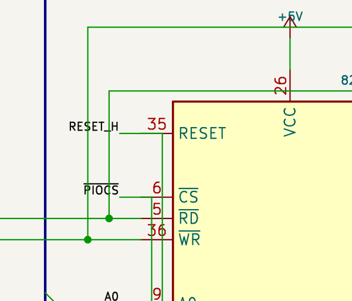
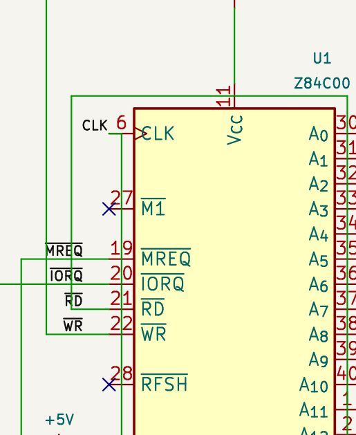
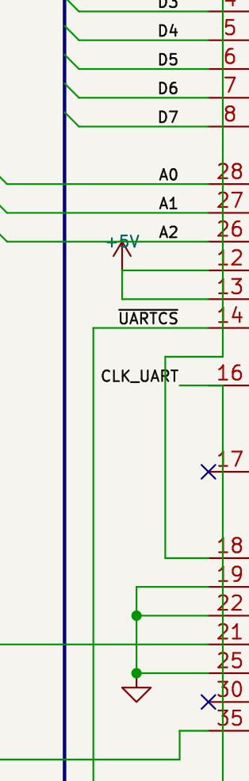

= Mark's schematic review: readable wiring and an independent drawing approach
:title: {docname}
:revdate: 2026-11-09
:toc:

== Mark's words, preserved verbatim

Falken supplied this review of our wired schematic:

[quote,Mark]
____
That doesn’t look too bad but you should tell it not to allow signals to cross text or symbols, including the pins and pin numbers on symbols.

There are also a few where I would suspect there is no connection to the component if I see it in eagle, but kicad might be different. For example the reset signal to pin 35 on the 8255 shows two signal connections to the pin but no dot to indicate there are three points connecting. I think it would be clearer if only one signal connection on each pin.
____

Falken also clarified the purpose of studying Andrew's drawing:

[quote,Falken]
____
sure, but dont copy him, we are curious for yours approach :-)
____

This review therefore records concrete defects and reusable drawing principles. It does not adopt Andrew's schematic coordinates or replace our independent component arrangement. The PCB rerouting experiment remains paused. No schematic wires or component positions were changed during this review.

== What the inspection confirmed

The reviewed link:../schematics/02-wired-a3/Z80_Simple_Computer.kicad_sch[human-edited single-A3 schematic] has SHA-256 `b5ab1a59ff58a9e4e2632a093ed8b1fc5d4799a8a48e9c9ada20fd35b38152fd`.

Fresh native KiCad exports report zero ERC findings and exactly the same 301 pin-to-net assignments, component values and footprints as the authoritative circuit. See the link:../reports/schematic-wired-a3/mark-review-261109-2306/erc.json[ERC report], link:../reports/schematic-wired-a3/mark-review-261109-2306/netlist.xml[netlist] and link:../reports/schematic-wired-a3/mark-review-261109-2306/pin-anchor-review.json[pin-anchor analysis]. Electrical checks passing does not establish drawing readability.

[cols="1,3,3",options="header"]
|===
|Area |Observed problem |Direction for a later cleanup
|CPU U1 |A clock-route bend passes across the visible CLK pin graphic; another run crosses the VCC pin-number area. Control labels also have unrelated vertical routes through their text. |Reserve the complete visible pin area, pin-number text and label extent. Approach the clock pin from outside its symbol, with a clean final straight segment.
|PPI U4 |RESET pin 35 and CS pin 6 each have a wire continuing inward over the drawn pin. The RESET_H and PIOCS label areas are crossed by vertical routes. |Keep one outward wire at each pin anchor. Put branch points in open wire space, then place labels on clear runs.
|UART U5 |XIN pin 16 has the same inward wire continuation. Its CLK_UART label is crossed by another control route; the A2/+5V region is also crowded. |Separate the clock and control approaches. Leave room for both supply-symbol text and address labels.
|Decode gates and ROM |U8 pins 1 and 9 and U3 pin 20 also have collinear wire continuations over their drawn pins. |Apply the same clean terminal approach consistently, including small gate symbols.
|MAX232 / DE9 |The serial routes are connected, but closely spaced labels and several long crossing paths make following a signal unnecessarily difficult. |Give each serial signal a readable lane; shorten local detours without disturbing Falken's capacitor placement or repaired supply connections.
|===

These are confirmed examples from enlarged renders, rather than an exhaustive automated text-collision audit. The crops below preserve the observed state:

.PPI reset and chip-select approaches

.CPU clock and control approaches

.UART clock and control approaches

The link:../reports/schematic-wired-a3/mark-review-261109-2306/max232.png[MAX232 / DE9 detail] records the serial area separately.

== The specific reset-pin question

U4 pin 35 is connected to `/RESET_H`. The fresh native netlist places U4.35, U5.35, U7.2 and U7.3 on that net.

At U4.35's anchor, `(224.79, 60.96)` mm, two saved wire objects meet: one from `(222.25, 60.96)` and one continuing to `(227.33, 60.96)`. There is no explicit junction-dot object there. The second segment continues toward the symbol over its red pin graphic. KiCad's exported connectivity confirms the electrical connection in this file; the visual ambiguity Mark identified is real.

The analysis found this left/right wire continuation at six non-power-symbol pin anchors: U4.35, U4.6, U5.16, U8.1, U8.9 and U3.20. These are not six missing electrical connections. All six patterns were already present in the original machine drawing at commit `1184700`; they were not introduced by Falken's later presentation edits.

The preferred correction is to remove redundant inward wire tails and provide one outward approach per pin. Where a real branch is required, move it onto a clear external wire and show its junction explicitly. Simply adding a dot to the present overlapping geometry would leave much of the readability problem intact. Every such cleanup must be checked against a fresh native netlist.

Our existing sheet caption, “Crossings connect only at dots,” is too abbreviated for this example. A future wording should distinguish unjoined crossings from connections at pin anchors and wire endpoints. It must describe the actual saved connectivity rather than imply that every connected pin requires a dot.

== What to learn from Andrew without copying his drawing

The historical link:../reference/firstz80/66a5a63/FirstZ80.kicad_sch[FirstZ80 schematic], recovered through the saved Reddit discussion, was rendered and inspected. Its source is https://github.com/lynchaj/duodyne/tree/66a5a63fd8338d12c115bc2bee5dff2f435afae4/%21Development/FirstZ80[Andrew Lynch's January 2024 revision]. This is a different, expanded circuit from the Scherrer GIF and our current wired version.

Useful observed habits include functional grouping, substantial open space between groups, short named address/data stubs, support parts placed near their circuit, and a self-contained supply block. These give the reader recognizable local circuits before asking them to follow longer control paths. They are engineering communication principles, not a set of coordinates to imitate.

There is also a paper-size difference: Andrew's native file uses ANSI C, 558.8 x 431.8 mm; our drawing uses A3, 420 x 297 mm. His use of short named bus signals also reduces the amount of drawn wiring. The drawings therefore have different space and presentation constraints. This inspection does not certify every detail of the reference schematic, and the PCB file alone does not establish whether its original tracks were routed manually or automatically.

== Our own approach for the next drawing pass

. Keep our functional placement and the human refinements. First identify local congestion around each symbol, rather than copying the reference arrangement or regenerating the sheet.
. Treat symbol bodies, complete pin graphics, pin numbers, visible fields, labels, no-connect markers and headings as reserved drawing space. A wire may meet its intended pin at the electrical anchor; it must not use the visible pin stroke as a routing corridor.
. Give each terminal a straight outward approach. Place branches away from pins. Use explicit, readable T-junctions and avoid ambiguous four-way joins.
. Allocate readable lanes between functional groups. Prefer a somewhat longer clear route over a shorter route through text. Keep the existing explicit A/D bus experiment unless a separate presentation variant is deliberately requested.
. Place or adjust labels after the nearby routes settle, using their full rendered extent. Check anchors separately from text placement so a cosmetic move cannot silently detach a label.
. Inspect enlarged renders as well as the whole A3 sheet. Native ERC and netlist equality remain electrical gates; rendered collision checks and human review are additional presentation gates.

For any later implementation, preserve the input first; retain all 301 pin assignments and component data; recheck continuous scalar paths and bus entries; refresh SVG/PNG/PDF only after validation. Keep the original generator overwrite guard active. Do not propagate drawing-only edits into the frozen PCB comparison projects.

== Compact reminders for Ari

* One clean outward wire per terminal; branch in open space.
* Reserve text and pin graphics, not only symbol bodies and connection anchors.
* Never trade visible clarity for a shorter schematic wire.
* A passing ERC does not prove that a human can read the drawing.
* Learn principles from Andrew; keep our own arrangement and explain our choices.
* Preserve Mark's wording and Falken's refinements. Recheck electrical attachments after every cosmetic change.
* The FirstZ80 fixed-placement PCB comparison and this schematic-readability review are separate tasks; routing remains paused here.
